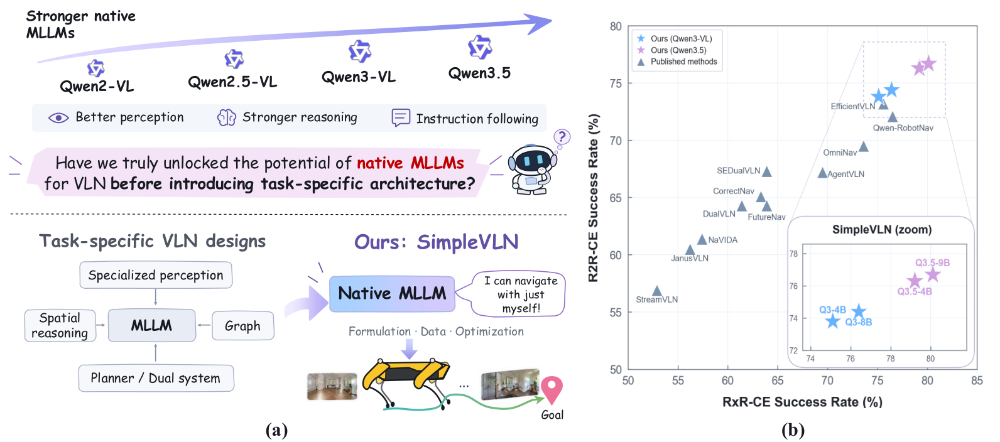
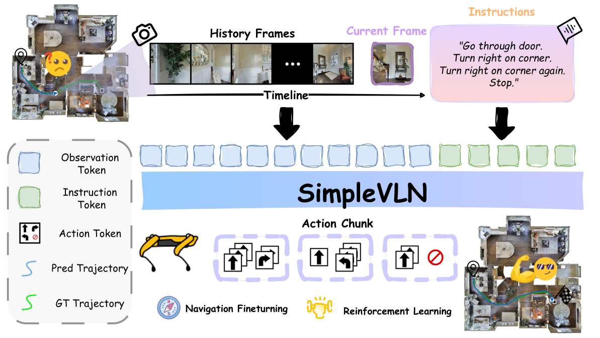

<h1 align="center">
  SimpleVLN: Towards Simple and Frontier Vision-Language Navigation With Native MLLMs
</h1>

<p align="center">
  <a href="#models"></a>
  <a href="#results"></a>
  <a href="#evaluation"></a>
  <a href="#data"></a>
</p>

## 🧭 Overview

**SimpleVLN** studies how far the capabilities of native multimodal large language
models can take vision-and-language navigation. It preserves the pretrained model
architecture and develops navigation capabilities through **formulation, data
construction, and progressive learning**.

- **A native navigation interface.** Single-turn inputs combine the instruction,
  current observation, and a bounded visual history. Action chunks let the model
  predict several navigation actions in one decision.
- **Learning from demonstrations and interaction.** Expert trajectories provide
  initial supervision, DAgger adds experience from states reached by the policy,
  and synthesized navigation tasks expand the task distribution for RL.
- **From action imitation to task completion.** A progressive IL–DAgger–RL pipeline
  first teaches navigation actions, then corrects errors under policy execution,
  and finally optimizes whether the agent reaches its goal.

SimpleVLN is studied across **Qwen2.5-VL, Qwen3-VL, and Qwen3.5** backbones.
With **Qwen3.5-9B**, it achieves **76.7% SR on R2R-CE** and **80.1% SR on RxR-CE**
on the `val-unseen` splits.



*Native MLLMs for navigation (left) and success-rate comparisons with existing
methods on R2R-CE and RxR-CE (right).*

## 🧩 Method

### Navigation as single-turn decisions

At each decision, SimpleVLN constructs a new multimodal input from the navigation
instruction, sampled visual history, and current RGB observation. It keeps the
input focused on the current navigation state without accumulating an ever-growing
conversation of observations and past actions.

SimpleVLN's global–local memory combines sparse observations from earlier in the
route with recent frames that preserve local continuity. Its fixed visual budget
keeps the context bounded as the episode grows. The native MLLM predicts an
**action chunk**: an ordered sequence of navigation actions that the environment
executes before the next model decision.



*The instruction, sampled history frames, and current observation form the model
input. The native MLLM directly predicts action chunks for navigation.*

### Progressive policy learning

The three learning stages address different sources of navigation error:

1. **Imitation learning** initializes the policy from expert demonstrations across
   R2R, RxR, and ScaleVLN, using the same decision-level input and action-chunk
   interface as inference.
2. **DAgger adaptation** adds corrective supervision for states encountered during
   policy execution, reducing the gap between expert trajectories and the agent's
   own experience.
3. **Reinforcement learning** optimizes task completion on synthesized navigation
   episodes in training scenes. A binary success reward allows successful routes
   beyond the demonstrated action sequence.

<a id="models"></a>

## 🤖 Models

SimpleVLN models use the following backbones:

| Backbone | Before RL | After RL |
|---|---|---|
| Qwen2.5-VL | [3B](https://huggingface.co/honglyhly/SimpleVLN_Qwen25VL_3B_SFT) · [7B](https://huggingface.co/honglyhly/SimpleVLN_Qwen25VL_7B_SFT) | — |
| Qwen3-VL | [4B](https://huggingface.co/honglyhly/SimpleVLN_Qwen3VL_4B_SFT) · [8B](https://huggingface.co/honglyhly/SimpleVLN_Qwen3VL_8B_SFT) | [4B](https://huggingface.co/honglyhly/SimpleVLN_Qwen3VL_4B_RL) · [8B](https://huggingface.co/honglyhly/SimpleVLN_Qwen3VL_8B_RL) |
| Qwen3.5 | [4B](https://huggingface.co/honglyhly/SimpleVLN_Qwen35_4B_SFT) · [9B](https://huggingface.co/honglyhly/SimpleVLN_Qwen35_9B_SFT) | [4B](https://huggingface.co/honglyhly/SimpleVLN_Qwen35_4B_RL) · [9B](https://huggingface.co/honglyhly/SimpleVLN_Qwen35_9B_RL) |

<a id="results"></a>

## 📊 Results

Reported results on the **R2R-CE and RxR-CE val-unseen** splits.
SR, SPL, and nDTW are shown in percentages; higher is better.

### After reinforcement learning

| Model | R2R-CE SR | R2R-CE SPL | RxR-CE SR | RxR-CE SPL | RxR-CE nDTW |
|---|---:|---:|---:|---:|---:|
| Qwen3-VL-4B | 73.8 | 66.7 | 75.1 | 65.3 | 71.5 |
| Qwen3-VL-8B | 74.4 | 69.5 | 76.4 | 66.4 | 77.4 |
| Qwen3.5-4B | 76.3 | 72.3 | 79.2 | 69.7 | **80.3** |
| Qwen3.5-9B | **76.7** | **72.6** | **80.1** | **69.9** | 79.8 |

Across these four models, RL improves SR by **7.5–10.2 points on R2R-CE** and
**11.7–16.1 points on RxR-CE** over their corresponding pre-RL policies.

<details>
<summary><b>Results before reinforcement learning</b></summary>

| Model | R2R-CE SR | R2R-CE SPL | RxR-CE SR | RxR-CE SPL | RxR-CE nDTW |
|---|---:|---:|---:|---:|---:|
| Qwen2.5-VL-3B | 51.6 | 44.9 | 50.3 | 42.0 | 57.6 |
| Qwen2.5-VL-7B | 59.1 | 52.0 | 58.9 | 49.2 | 62.9 |
| Qwen3-VL-4B | 65.4 | 58.8 | 63.4 | 54.1 | 66.5 |
| Qwen3-VL-8B | 64.2 | 57.0 | 64.2 | 54.3 | 66.2 |
| Qwen3.5-4B | 67.1 | 59.2 | 65.6 | 55.3 | 67.8 |
| Qwen3.5-9B | 69.2 | 61.2 | 64.0 | 54.2 | 67.0 |

</details>

<a id="data"></a>

## 📦 Evaluation Data

The R2R-CE and RxR-CE annotations are included under `eval/data/vln_data/`.

| Benchmark | Split | Episodes |
|---|---|---:|
| R2R-CE | `val_unseen` | 1,839 |
| RxR-CE, English guide | `val_unseen` | 3,669 |

The package includes the reference trajectories used for RxR nDTW and sDTW.
Both benchmarks share **11 Matterport3D scenes**, obtained through the
[official access process](https://niessner.github.io/Matterport/#download).
Prepare those scenes from an existing Habitat-format MP3D installation:

```bash
python eval/scripts/prepare_eval_data.py --mp3d-root /path/to/mp3d
```

The preparation script copies the required scene assets and validates the data.
The default layout is then ready for evaluation. See the
[data guide](eval/data/vln_data/README.md) for custom locations and validation.

<a id="evaluation"></a>

## 🚀 Evaluation

### Environment

Set up the evaluator using the [installation guide](eval/README.md#installation).
Install vLLM 0.18.0 for the model server in a separate environment, using
`eval/requirements-vllm.txt`. This release serves Qwen2.5-VL, Qwen3-VL, and Qwen3.5.
See the [vLLM 0.18.0 GPU installation guide](https://docs.vllm.ai/en/v0.18.0/getting_started/installation/gpu/).

### Run SimpleVLN

The evaluation examples use **SimpleVLN-Qwen3-VL-4B after RL**, with checkpoint
identifier `SimpleVLN_Qwen3VL_4B_RL`. Set `MODEL_PATH` to the local Hugging Face
checkpoint directory for the selected model.

Start the SimpleVLN model service in the vLLM environment:

```bash
MODEL_PATH=/path/to/SimpleVLN_Qwen3VL_4B_RL \
bash eval/scripts/serve_vllm.sh 1 1
```

Run both benchmarks in the evaluation environment:

```bash
EXP_NAME=simplevln_qwen3vl_4b \
VLLM_NUM_SERVERS=1 SPLIT_NUM=8 PASS_K=1 \
bash eval/scripts/eval.sh
```

Results are saved under `eval/results/simplevln_qwen3vl_4b/`. Rerun the same
command to resume an interrupted experiment; use a new experiment name when
changing the checkpoint or evaluation settings.

The [evaluation guide](eval/README.md) covers single-benchmark evaluation,
remote inference, visualization, and metric interpretation. Consult its
[evaluation settings](eval/README.md#evaluation-settings) when comparing a run
with the reported results.

## Acknowledgments

SimpleVLN builds on [Qwen](https://github.com/QwenLM),
[VLN-CE](https://github.com/jacobkrantz/VLN-CE),
[Habitat](https://github.com/facebookresearch/habitat-lab), and
[vLLM](https://github.com/vllm-project/vllm).
Benchmark sources, attribution, and data terms are documented in the
[dataset notice](eval/data/vln_data/NOTICE.md).

## Citation

If you find SimpleVLN useful in your research, please cite:

```bibtex
@article{hong2027simplevln,
  title   = {SimpleVLN: Towards Simple and Frontier Vision-Language Navigation},
  author  = {Hong, Lingyi and Cai, Weiren and Chen, Jiayu and Zhou, Xinyu and He, Bailin and Guo, Yunfei and Sun, Qiao and Liu, Xiang and Ma, Boyu and Yang, Jianfei and Zhang, Wenqiang},
  year    = {2027},
  url     = {https://github.com/simplevln/SimpleVLN}
}
```
